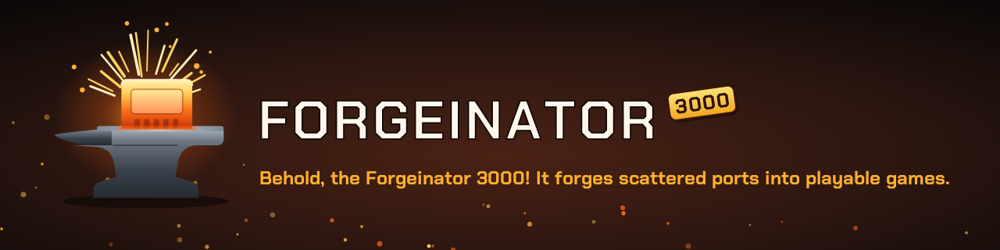

# Forgeinator 3000

> *¡Contempla el Forgeinator 3000! Forja ports sueltos en juegos jugables.*

**Una herrería de recompilaciones de consola y ports de PC para portátiles con Linux.** Forgeinator reúne ports y recompilaciones hechos por la comunidad desde muchas fuentes (releases de GitHub, catálogos, tus propios servidores) y los convierte en juegos que se abren desde el Modo Juego de Steam. Los descarga, los compila si hace falta, los instala, los mantiene al día y los lanza, con **táctil y mando**, sin teclado ni ratón.

> Antes se llamaba **Recomp Hub** (y por poco tiempo, Craftinador). [Read in English](README.md)

Forgeinator **nunca descarga juegos**. Cada port necesita tu propia copia legal del juego original. Forgeinator te dice qué archivo pide el port (serial, formato, hash), lo reconoce cuando se lo das y lo coloca donde el port lo busca.

## Qué hace

- **Catálogo** de ports y recompilaciones, cada uno enlazado al repositorio de su proyecto. Importa listas en formato `apps.json` o añade repositorios a mano.
- **Ficha del juego**: última release, builds disponibles para Linux y Windows, qué necesita el port de tu juego y el README del proyecto resumido.
- **Descargas**: gestor propio con cola, varias conexiones por archivo, pausa y reanudar (también tras reiniciar), reintentos y verificación SHA-256.
- **Instalación**: abre zip, 7z, rar, tar, AppImage, instaladores `.run` y builds de Windows de un solo `.exe`, encuentra el ejecutable y registra el juego en el launcher unificado.
- **Builds de Windows con Proton** (`umu-run`), también instaladores Setup, con un prefijo por juego y tus imágenes de disco como unidades.
- **Compilar desde el código** dentro de un contenedor distrobox (CMake, Meson, Cargo, Makefile o tu comando) cuando el proyecto no publica build.
- **Arranque directo**: los juegos se abren al momento, sin la pantalla de actualización del launcher, también desde sus accesos de Steam.
- **Steam**: accesos con arte (SteamGridDB) para que cada juego salga con su nombre en Big Picture.
- **Tus archivos del juego**: se reconocen por hash o serial desde un selector o vigilando tu carpeta de descargas, y se enlazan en una biblioteca con estructura ES-DE.
- **Bibliotecas remotas**: WebDAV, Samba, SFTP, FTP, cualquier remoto de rclone o una carpeta montada, por sistemas (estructura ES-DE). Las descargas las hace un servicio en segundo plano (`forgeinatord`) que sigue aunque cierres el Hub.
- **Complementos**: conectores extra que se instalan desde un zip (Ajustes › Archivos › Complementos), para servidores con API propia. Incluye «Catálogo HTTP v1». Cómo escribir uno: [docs/PLUGINS.md](docs/PLUGINS.md); conexiones y API: [docs/PROTOCOL.md](docs/PROTOCOL.md).
- **Informes de error y sugerencias**: vista previa con tokens, cookies y tu usuario tapados; se guarda como zip o se abre como issue de GitHub ya rellenado.
- **Temas**: 15 temas clásicos con 59 paletas y 8 identidades experimentales del «Estudio». Accesibilidad: movimiento reducido, alto contraste, texto grande; tres niveles de calidad.

## Requisitos

- Linux con el Modo Juego de Steam / Gamescope (desarrollado y probado en **Bazzite**, ROG Ally). El modo escritorio también funciona.
- Python **3.11+** y [`pygame-ce`](https://pyga.me/): `pip install --user --break-system-packages pygame-ce`
- Opcional: `umu-run` (builds de Windows con Proton; viene en Bazzite), `distrobox` (compilar), `7z`/`unar` (archivos 7z y rar).

## Instalar

**Como app del QAM (recomendado, con [QAM Rail](https://github.com/pascaltll/qam-rail) 0.51 o más):** Apps › Instalar app › Desde GitHub › `pascaltll/Forgeinator`. QAM Rail descarga `forgeinator-X.zip` de la [última release](../../releases/latest), comprueba su SHA-256, lo instala en `~/homebrew/qam-apps/forgeinator` y avisa cuando hay una versión nueva.

**A mano** (sin QAM Rail): descomprime `forgeinator-X.zip` en `~/homebrew/qam-apps/` y ejecuta `~/homebrew/qam-apps/forgeinator/install.sh`. Para abrirlo: `~/homebrew/qam-apps/forgeinator/bin/forgeinator` (añádelo a Steam como juego no-Steam para el Modo Juego).

### Canales: estable y dev a la vez
| | Estable | Dev |
|---|---|---|
| Carpeta | `~/homebrew/qam-apps/forgeinator` | `~/homebrew/qam-apps/forgeinator-dev` |
| Se actualiza | desde el QAM (releases de GitHub) | con `recomp-hub-update-vX.zip` en `~/Games/actualizaciones` |
| Ajustes | `~/.config/forgeinator/stable` | `~/.config/forgeinator/dev` |

Las dos comparten la biblioteca (`~/.local/share/forgeinator`: juegos, descargas, ROMs enlazadas, arte) y las claves (`~/.config/forgeinator`). Solo la copia **activa** ajusta los atajos de los juegos en Steam y la apariencia que leen el lanzador y el QAM. Para elegirla: Ajustes › Mantenimiento › Canal, o `bin/forgeinator --canal estable|dev|estado`. Si dev no llega a arrancar bien dos veces seguidas, la activa vuelve a ser la estable sola.

`bin/forgeinator --active` abre siempre la copia activa (útil para un único atajo de Steam).

**Instalación antigua** (`~/Games/recomp-hub`, con `install-hub-vX.sh`): sigue funcionando. Si además tienes Forgeinator en el QAM, la primera vez que se abre una copia del QAM se copia tu `data/` a la biblioteca común (sin borrar ni mover nada; lo pesado, con enlaces duros) y el atajo antiguo abre la copia activa del QAM. `HUB_LEGACY=1` abre la antigua igualmente.

## Controles

| | Mando | Táctil |
|---|---|---|
| Moverse | cruceta / stick izquierdo | tocar |
| Abrir / pulsar | A | tocar |
| Atrás | B | botón ‹ ATRÁS |
| Acciones extra | X / Y (se ven abajo) | botones |
| Pestañas | LB / RB | pestañas arriba |
| Desplazar | cruceta | arrastrar (con inercia) |
| Menú del juego | Y (sobre un juego) | mantener pulsado |

## Tus datos y tu privacidad

Tu biblioteca vive en `~/.local/share/forgeinator`, tus ajustes en `~/.config/forgeinator/<canal>` y los registros en `~/.local/state/forgeinator/<canal>` (en una instalación antigua, todo en `data/`). El token de GitHub se guarda en `~/.config/forgeinator/credentials.json` con permisos 600, fuera del programa. Nada de eso forma parte de este repositorio ni se envía a ningún sitio. Forgeinator solo habla con GitHub y con los servicios que configures (SteamGridDB, ScreenScraper, tus bibliotecas remotas y los servidores a los que se conecten tus complementos).

## Desarrollo

```bash
git clone https://github.com/pascaltll/Forgeinator && cd Forgeinator
python3 -m pip install --user pygame-ce pytest
python3 -m pytest tests -q          # ~1400 pruebas, sin pantalla (driver SDL dummy)
python3 main.py                     # ejecutar desde el código
```

Estructura: `hub/` (la aplicación), `bin/` (arranque, actualización, doctor y pruebas; `forgeinatord` es el servicio en segundo plano y `forgeinator-ctl` el control sin interfaz), `plugins/` (complementos de ejemplo), `docs/` (protocolos y guía de complementos), `catalog/` (catálogo base y sistemas de ES-DE), `browser/` (navegador integrado opcional), `assets/` (iconos y logos de consola), `tests/`.

Mira [CONTRIBUTING.md](CONTRIBUTING.md). Historial de versiones: [CHANGELOG.md](CHANGELOG.md).

## Hoja de ruta

1. ~~Repositorio público.~~ Hecho (3.12).
2. ~~App instalable: programa y datos separados, canales estable y dev, instalación desde el QAM, actualizaciones desde las releases de GitHub.~~ Hecho (3.15–3.19).
3. ~~Informes de error con los secretos tapados y un toque para abrir un issue de GitHub ya rellenado.~~ Hecho (3.24).
4. **Forgeinator Link**: vincula tu teléfono con un QR en tu red local para enviar claves, cookies y archivos grandes (ISO) a tu biblioteca.
5. ~~Bibliotecas remotas con estructura ES-DE, servicio de descargas en segundo plano, complementos y protocolos documentados.~~ Hecho (3.22–3.25); falta la tarjeta «Descargas» del QAM.

## Licencia

Forgeinator es software libre bajo la **GNU General Public License v3.0**. Ver [LICENSE](LICENSE). El material de terceros y sus licencias están en [THIRD_PARTY.md](THIRD_PARTY.md).

No está afiliado a Valve, Sony, Nintendo, Microsoft, Sega ni a ninguna otra empresa. Los nombres y logos de consolas son marcas de sus dueños y solo se muestran para identificar plataformas.
