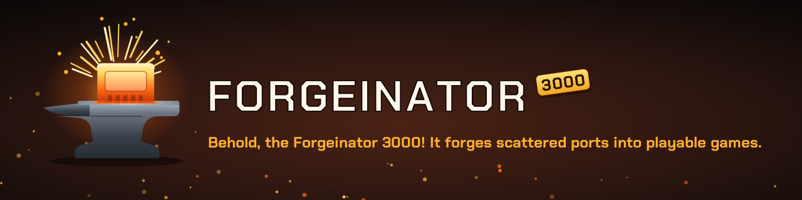

# Forgeinator 3000

> *Behold, the Forgeinator 3000! It forges scattered ports into playable games.*

**A forge for console recompilations and PC ports on Linux handhelds.** Forgeinator gathers fan-made ports and recompilations from many sources (GitHub releases, catalogs, your own servers) and turns them into games you can play from Steam's Game Mode. It downloads them, builds them if needed, installs them, keeps them updated and launches them, with **touch and gamepad** controls, no keyboard or mouse needed.

> Formerly **Recomp Hub** (and briefly Craftinador). [Leer en español](README.es.md)

Forgeinator **never downloads games**. Every port needs your own legally obtained copy of the original game. Forgeinator tells you which file a port expects (serial, format, hash), recognizes it when you provide it, and places it where the port looks for it.

## Features

- **Catalog** of ports and recompilations, each linked to its project repository. Import lists in `apps.json` format or add repositories by hand.
- **Game page**: latest release, the available builds for Linux and Windows, what the port needs from your game, the project README summarized.
- **Downloads**: its own download manager with queue, several connections per file, pause/resume (also after a restart), retries and SHA-256 verification.
- **Install**: unpacks zip, 7z, rar, tar, AppImage, `.run` installers and single Windows `.exe` builds, finds the executable and registers the game in the unified launcher.
- **Windows builds through Proton** (`umu-run`), including Setup installers, with a per-game prefix and your disc images linked as drives.
- **Build from source** inside a distrobox container (CMake, Meson, Cargo, Makefile or your own command) when a project publishes no build.
- **Direct start**: games open straight away, without the launcher's update screen, also from their Steam shortcuts.
- **Steam**: shortcuts with artwork (SteamGridDB) so each game shows with its own name in Big Picture.
- **Your game files**: recognized by hash or serial from a file picker or a watched downloads folder, linked into an ES-DE style library.
- **Themes**: 15 classic themes with 59 palettes, plus 8 experimental "Studio" identities. Accessibility options: reduced motion, high contrast, large text; three quality levels.

## Requirements

- Linux with Steam Game Mode / Gamescope (developed and tested on **Bazzite**, ROG Ally). Desktop mode also works.
- Python **3.11+** and [`pygame-ce`](https://pyga.me/): `pip install --user --break-system-packages pygame-ce`
- Optional: `umu-run` (Windows builds through Proton, preinstalled on Bazzite), `distrobox` (building from source), `7z`/`unar` (7z and rar archives).

## Install

Download `install-hub-vX.sh` from the [latest release](../../releases/latest) and run:

```bash
bash install-hub-vX.sh            # installs to ~/Games/recomp-hub
FORCE=1 bash install-hub-vX.sh    # reinstall the code; your data/ is kept
~/Games/recomp-hub/bin/hub        # open the interface
```

Add `~/Games/recomp-hub/bin/hub` to Steam as a non-Steam game to use it from Game Mode. Later versions are applied automatically: drop the `recomp-hub-update-vX.zip` file in `~/Games/actualizaciones`. Installing from the QAM and updating from GitHub releases are planned (see the roadmap below).

## Controls

| | Gamepad | Touch |
|---|---|---|
| Move | D-pad / left stick | tap |
| Open / press | A | tap |
| Back | B | ‹ BACK button |
| Extra actions | X / Y (shown at the bottom) | buttons |
| Tabs | LB / RB | tabs at the top |
| Scroll | D-pad | drag (with inertia) |
| Game menu | Y (on a game) | long press |

## Your data and privacy

Your settings, downloads, logs and backups live in `data/` inside the install folder. Your GitHub token is stored in `~/.config/recomp-hub/credentials.json`, outside the project. None of it is part of this repository and none of it is sent anywhere. Forgeinator only talks to GitHub and the services you configure (SteamGridDB, ScreenScraper, your own catalog server).

## Development

```bash
git clone https://github.com/pascaltll/Forgeinator && cd Forgeinator
python3 -m pip install --user pygame-ce pytest
python3 -m pytest tests -q          # ~1400 tests, headless (SDL dummy driver)
python3 main.py                     # run from the source tree
```

Layout: `hub/` (application), `bin/` (launch, update, doctor and test scripts), `catalog/` (base catalog and ES-DE systems), `browser/` (optional embedded browser), `assets/` (icons and console logos), `tests/`.

See [CONTRIBUTING.md](CONTRIBUTING.md). Version history: [CHANGELOG.md](CHANGELOG.md) (in Spanish).

## Roadmap

1. Public repository (this step).
2. Installable app: program and user data separated, install from the QAM, updates from GitHub releases.
3. Error reports with secrets redacted, one tap to open a prefilled GitHub issue.
4. **Forgeinator Link**: pair your phone through a QR code on your local network to send API keys, cookies and large files (ISOs) into your library.
5. Remote libraries (WebDAV, SMB, SFTP, cloud drives) with an ES-DE folder layout, and a documented protocol for catalog servers.

## License

Forgeinator is free software under the **GNU General Public License v3.0**. See [LICENSE](LICENSE). Third-party material and its licenses are listed in [THIRD_PARTY.md](THIRD_PARTY.md).

Not affiliated with Valve, Sony, Nintendo, Microsoft, Sega or any other company. Console names and logos are trademarks of their owners, shown only to identify platforms.
